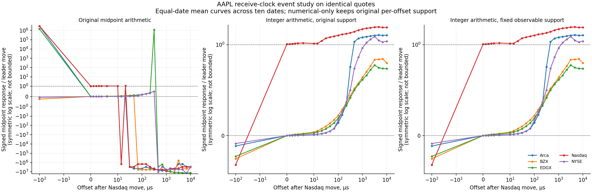
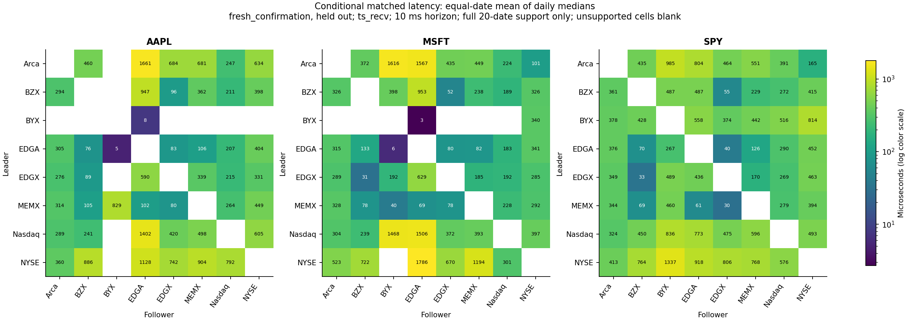
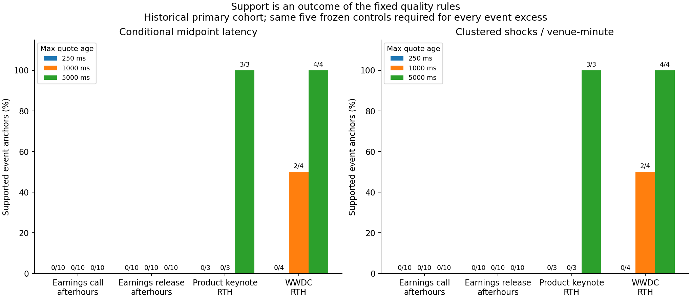
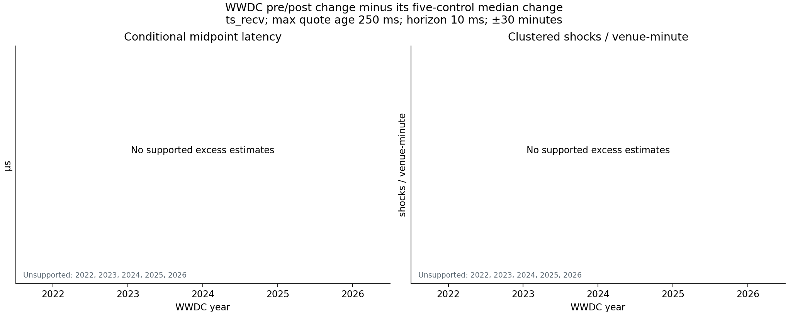
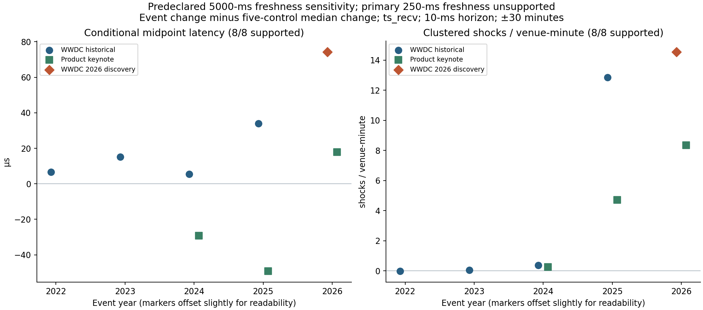
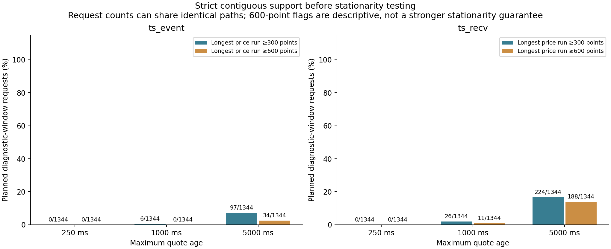
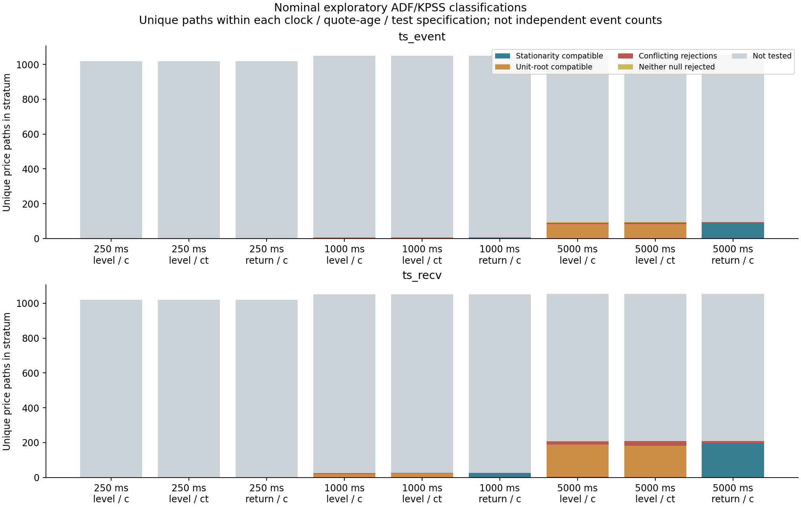

# Audited latency and Apple event results

This compact publication bundle lets teammates inspect the numbers without ignored local run directories or raw market data. All four independent audits pass. See the [sanitized audit snapshots](audits.json), [original-source and bundle hashes](provenance.json), and [bundle checks](bundle_checks.json).

## What the code corrections changed

On **50 identical saved requests / 4,988,927 records**, integer midpoint arithmetic removes **122 float-only triggers** from 2,793,998 floating midpoint detections. The maximum absolute mean AAPL response ratio falls from **129,185,438 to 2.169**; MSFT falls from **8,850,376 to 2.346**. Tiny false denominators caused those extreme ratios. Signed ratios can still legitimately be negative or exceed one.

All **1,200 bid/ask first-passage comparisons remain identical** under numerical-only correction. Fixed-bin cross-products change 195/600 peak-lag estimates; the median absolute change among changed tasks is 20 microseconds. These shifts do not establish faster market reactions. The teammates' original three full-day/IEX source files were unavailable; this is a controlled rerun on shared saved windows.

[Correction counters](tables/correction_summary.json) · [Ratio diagnostics](tables/correction_ratios.csv)

## Native quote latency

The primary comparison uses twenty held-out dates, a 10-ms matching horizon and 250-ms quote freshness. For each fully supported directed pair, it averages daily conditional matched-event medians with equal date weight; the displayed value is the median across pair estimates. It is not a pooled-event median or an unconditional response time.

| Symbol | Receive clock, microseconds | Exchange clock, microseconds |
|---|---:|---:|
| AAPL | 338.75 | 256.88 |
| MSFT | 302.35 | 204.93 |
| SPY | 431.50 | 352.48 |

The clock cohorts can differ. The CSV retains supported-pair counts, complete-horizon denominators and match rates. The required primary calm/volatile comparison is unsupported; it neither replicates nor rejects the team's volatility claim.

[Primary latency table](tables/latency_primary.csv) · [Scope and definitions](tables/latency_scope.json)

## Apple events, 2022–2026

The study has **28 anchors in 18 bundles**, each with five sampled same-year/weekday/local-time controls: five WWDCs, three product launches, ten earnings releases and ten calls. Release/call anchors share quarterly bundles. Already-inspected WWDC 2026 is discovery, separate from historical replication.

The fixed Nasdaq/Arca/BZX/EDGX panel requires 90% book coverage on every venue, all twelve directed pairs, complete follow-up and all five supported controls. Conditional latency additionally requires twenty matches per pair. **No event has a complete primary 250-ms-freshness, 30-minute pre/post comparison at the 10-ms horizon.** Missing estimates remain blank, not zero.

The following is the **predeclared 5000-ms freshness sensitivity**, not the primary result. Values are event pre/post change minus median control change, summarized with equal bundle weight. Freshness is maximum quote age, not measured reaction latency.

| Event class | Supported bundles | Receive-clock median excess, microseconds | Exchange-clock median excess, microseconds |
|---|---:|---:|---:|
| Historical WWDC, 2022–2025 | 4/4 | +10.96 | +6.89 |
| Product launches | 3/3 | -29.23 | +11.15 |
| Earnings releases | 0/10 | Unestimated | Unestimated |
| Earnings calls | 0/10 | Unestimated | Unestimated |

All four historical WWDC excesses are positive, but product-launch medians reverse sign across clocks. After-hours freshness gaps and conservative conflicting-timestamp barriers restrict earnings support. Unsupported earnings comparisons do not show zero earnings impact. Session differences, few bundles, other news and selected observation cohorts prevent a causal event-class ranking.

[Event scope](tables/event_scope.json) · [Class latency table](tables/event_class_latency.csv) · [Event/control excesses](tables/event_latency_excess.csv)

The compact CSVs retain every clock, freshness and support status for the primary 30-minute contrast at 10 ms. Nested exclusion/control/year lists are omitted; excluded-event/control counts, event failure reasons and leave-one-year-out class extrema remain.

## Separate stationarity diagnostics

ADF/KPSS use one-second strict-prior samples and the earliest longest uninterrupted healthy segment in each pre/post window. No gaps, quality barriers or days are joined. Each transformed series needs 300 observations; 300 prices yield only 299 returns. ADF uses BIC lags and KPSS automatic bandwidth, preserving bounded KPSS p-values.

Of **8,064 planned windows / 3,631 distinct price paths**, only 318 paths support all three specifications. Neither clock supplies a 300-point run at primary 250-ms freshness; tested evidence comes from 1000/5000-ms sensitivities.

| Nominal paired classification | Log levels, constant | One-second log returns, constant |
|---|---:|---:|
| Stationarity-compatible | 4 | 304 |
| Unit-root-compatible | 277 | 0 |
| Conflicting rejections | 29 | 14 |
| Inconclusive | 8 | 0 |

All 318 return ADF tests reject a unit root after global Holm adjustment across 954 computed ADF tests. Dependent, selected intraday segments do not prove stationarity or choose a transformation automatically. No transformation changes the native level-based latency matcher; first-passage matching does not require stationary levels. Per-venue tests do not establish common-sample VAR/VECM or cointegration support.

[Global diagnostic table](tables/stationarity_global.csv) · [Coverage](tables/stationarity_coverage.csv) · [Diagnostic scope and limitations](tables/stationarity_summary.json)

## Verification and publication scope

The event audit checks 640 source hashes and 82,243 sampled native matching cases with no mismatches. The stationarity audit recomputes every paired test and Holm value and independently rebuilds 192 selections from three raw groups, with no mismatches. These are bounded audits, not a second reconstruction of every raw event.

This bundle contains aggregate summaries and figures only: no credentials, machine-specific paths, raw DBNs, tick observations, sampled/grid prices or serialized models. Provenance identifies the original local run artifacts by repository-relative path and SHA-256; those artifacts are not shipped here. Audit copies are explicitly sanitized derived snapshots. The README uses relative bundle links instead of copying HTML that depends on ignored local outputs. No market-data requests were made to prepare this bundle.
