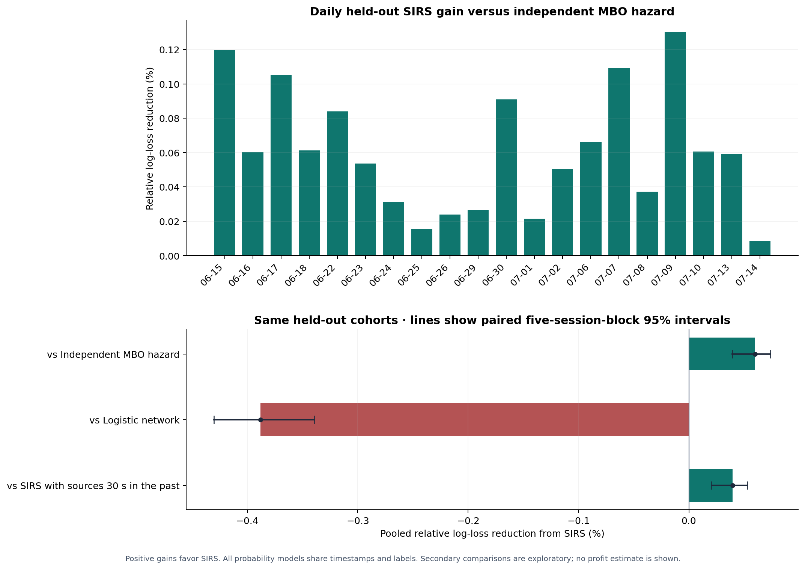
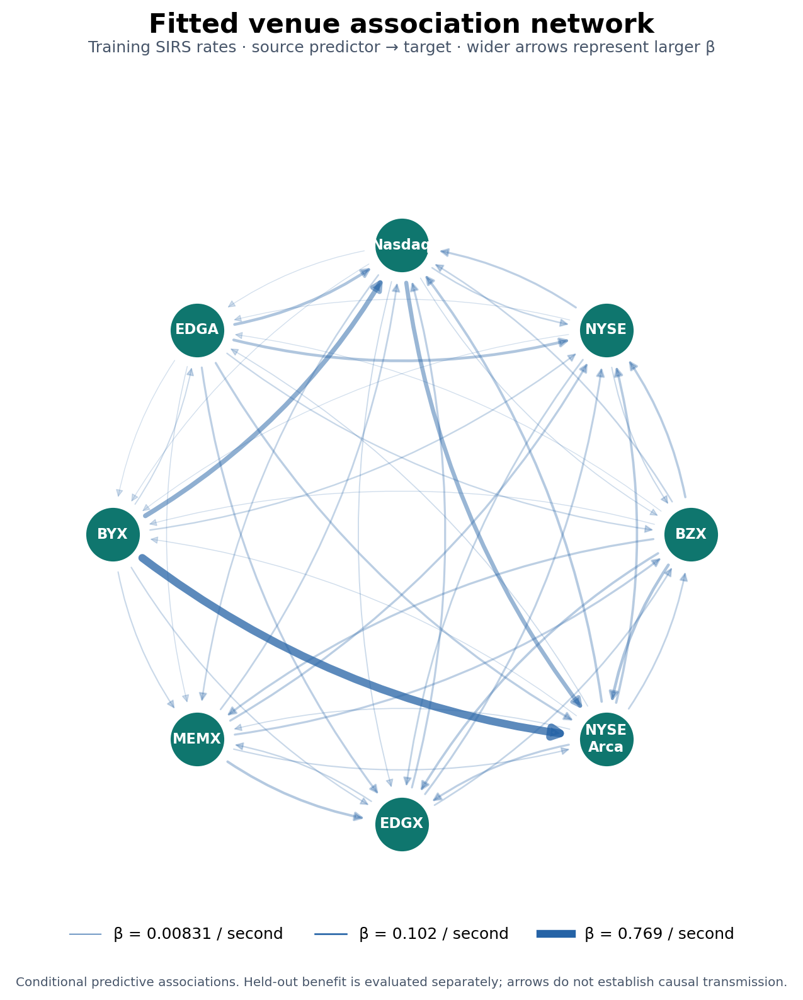
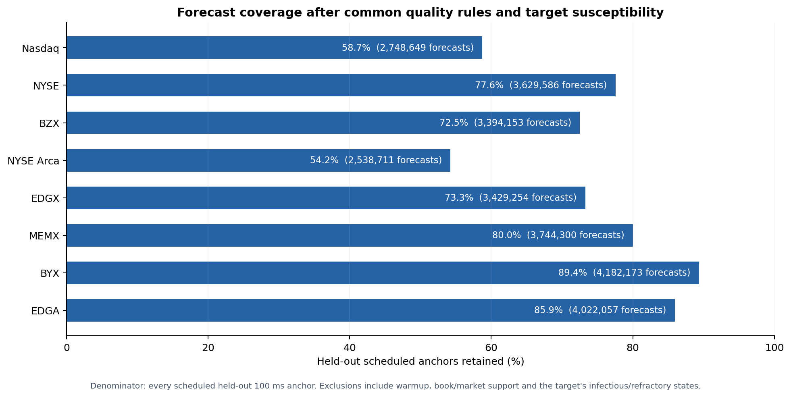
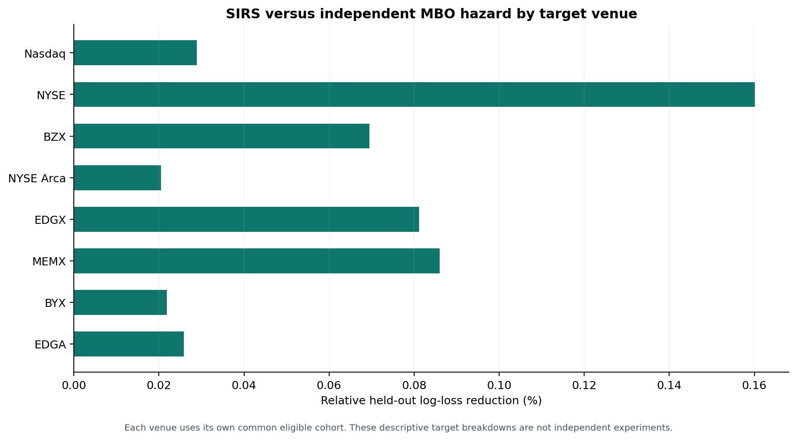
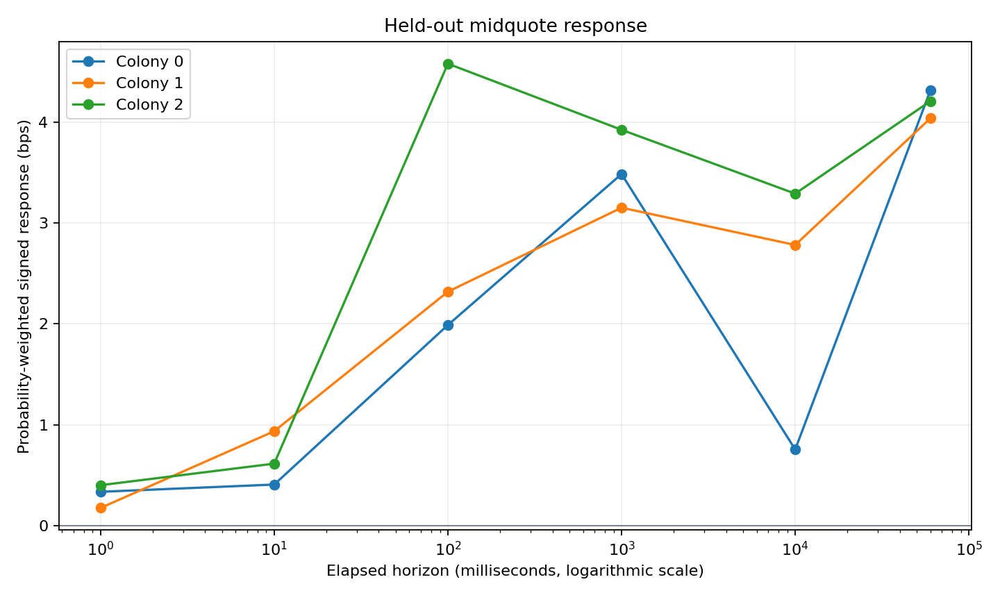
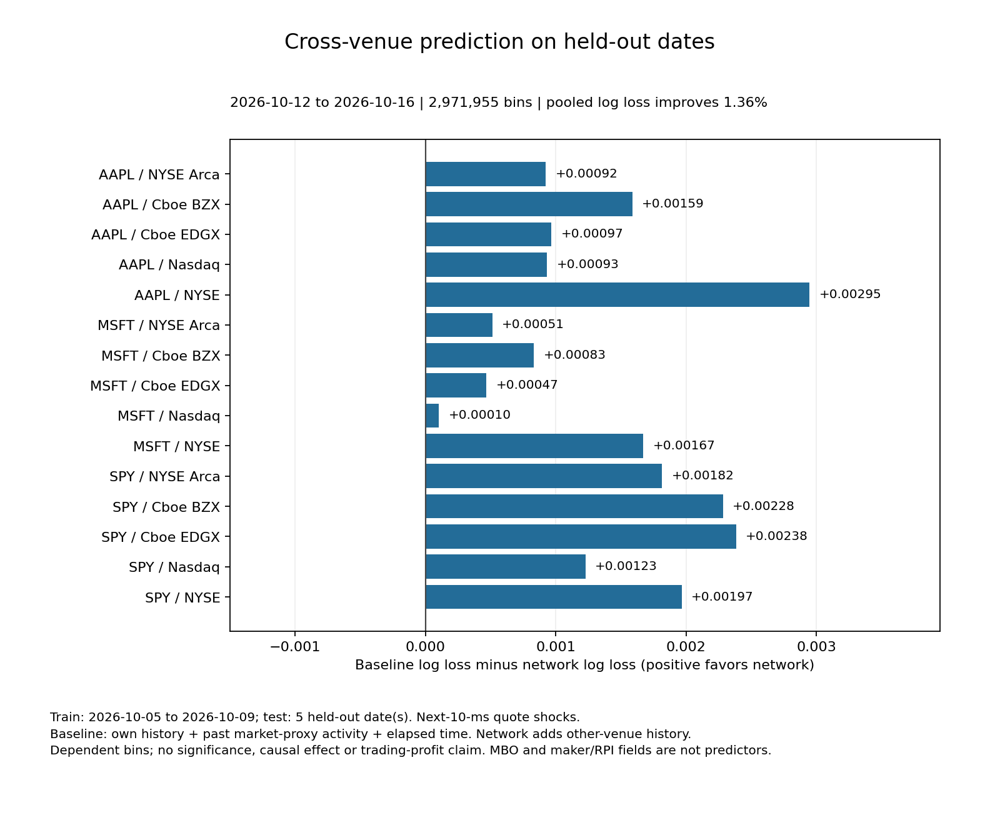
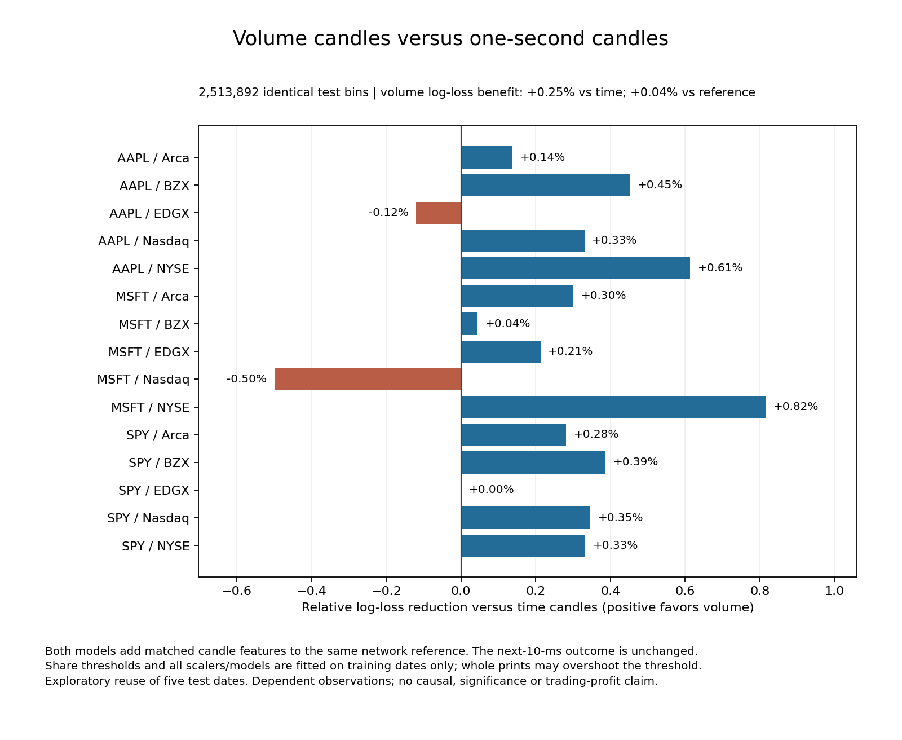
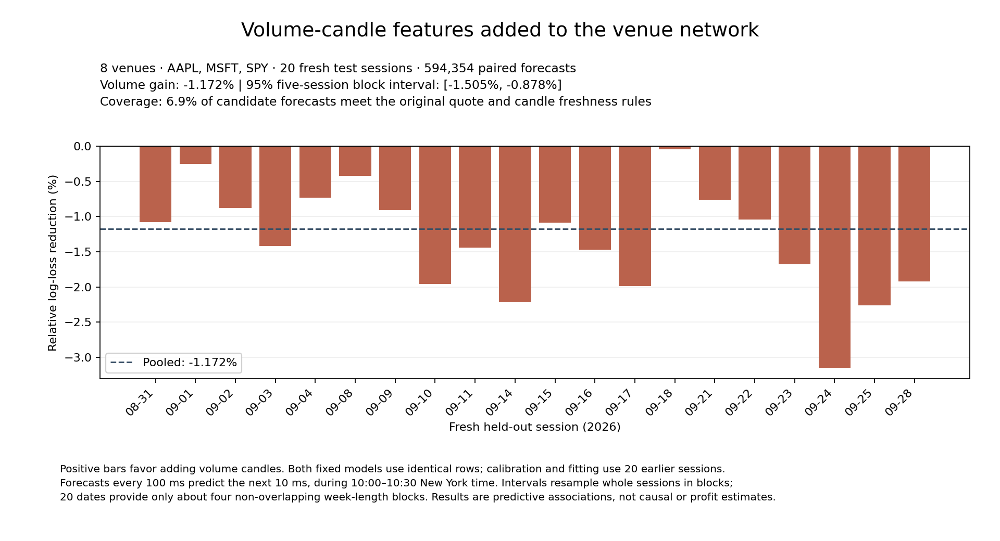

# Earlier ColonyLab studies, including full-session MBO/SIRS

This compact public bundle covers the earlier research alongside the newer [latency/event/stationarity bundle](../README.md). The [full project overview and protocols](../../README.md) describe the scientific methods. All values here summarize original saved runs; importing the source does not rerun their market-data studies. No raw DBNs, trades, ticks, sampled/grid prices, individual forecasts, model pickles or credentials are included.

## Main findings

| Study | Result | Interpretation |
|---|---|---|
| Trade-context colonies | AAPL prototype: 21,687 records / 1,149 trades; three mixture components; 266 training and 129 holdout events | Descriptive execution-context grouping, not identified investors or stable profitable colonies; directions mostly estimated and feed-specific conditions were not fully audited in this first prototype. |
| Five-venue shock prediction | Other-venue history reduces held-out log loss by 1.363%, on 2,971,955 scored bins across five held-out dates | Modest conditional predictive information; dependent observations and selective coverage prevent causal or profitability claims. |
| Volume versus time candles | Volume improves log loss 0.247% versus one-second candles, but only 0.042% versus the existing network | Exploratory reuse of already inspected test dates. |
| Fresh-date volume confirmation | Added volume features worsen held-out log loss by 1.1725%; five-session block gain interval [-1.505%, -0.878%] | The earlier small incremental network gain does not replicate under the frozen specification. |
| Full-session SIRS | SIRS gains 0.0601% versus an independent hazard, but loses 0.3883% versus the logistic network | Weak cross-venue predictive information; the logistic family is the stronger predictor on this sample. |

## Full-session MBO reconstruction and recurrent SIRS

The AAPL study spans eight venues and thirty full sessions: ten training sessions and twenty held-out sessions. All 510 requests / 532,658,530 records completed, including 527,567,665 native MBO records. The integer order-book engine retains displayed orders at every level, handles add/modify/cancel/clear semantics, and avoids double-removing informational trades/fills. Quality/reset/unfinished-event barriers remain active; quiet initialized books persist.

All 240 venue/day validation windows pass: 4,228,249 matched MBP-10 top-ten keys, zero mismatches and zero missing keys. These are five-minute validation windows per venue/day, not proof of continuous upstream feed completeness. Arca's provider-reported degraded dates remain in the frozen design, and unavailable intervals are excluded consistently from every model.

A qualifying shock creates 100 ms of infection, then 100 ms of refractoriness, then susceptibility. Durations are fixed definitions; nonnegative directed source coefficients are fitted in a conditional additive hazard. Susceptible targets are scored for a shock in the next 10 ms, with sources strictly preceding the two-millisecond lead. Order-book depth/imbalance/flows, own history, time and market controls are shared. The independent hazard, SIRS, refitted logistic network and past-shifted SIRS use identical forecast rows.

| Reference for SIRS | Relative SIRS log-loss gain | Five-session block 95% interval |
|---|---:|---:|
| Independent MBO hazard | +0.0601% | [+0.0393%, +0.0739%] |
| Logistic network | -0.3883% | [-0.4302%, -0.3394%] |
| SIRS sources shifted 30 seconds into the past | +0.0397% | [+0.0206%, +0.0528%] |

All 32 model fits converge, with zero numerical-guard rows. The held-out cohort has 27,688,883 task forecasts / 324,223 positive shock labels, retaining 73.955% of scheduled anchors. These are dependent forecasts, not independent experiments. Inference resamples whole dates or five-session blocks; twenty dates contain only about four non-overlapping blocks. The primary confirmation flag concerns SIRS versus the independent hazard, not superiority to the logistic network. The fitted graph is an unsigned conditional shock-risk association, not causal contagion, maker identity, epidemiological R0 or trading profit. Venue-specific shock thresholds also differ economically.

[SIRS scope and complete aggregate comparisons](tables/sirs_summary.json) · [Model scores](tables/sirs_model_scores.csv) · [Comparison table](tables/sirs_comparisons.csv) · [Daily scores](tables/sirs_daily_scores.csv)

## Clustering, shock prediction and volume features

The colony prototype uses fourteen strictly past trade/quote features, training-only scaling, a three-component Gaussian mixture, chronological separation and an outcome-horizon embargo. EQUS.MINI is an anonymized aggregate feed; the responsibilities are mixture assignments, not participant identities. The first prototype has weaker feed-condition validation than later native-feed studies.

The native-feed research progressed from a three-venue pilot to five-venue, three-stock replication. Logistic models predict next-10-ms shock arrivals using own history and market controls, then add strictly past same-stock shocks from other venues on the same rows. Directed response studies retain shifted-time controls. At 100 ms the wider association study shows -4.06 percentage points versus controls; the two-millisecond exclusion and target shock separation prevent interpreting that as inhibition or causal contagion.

Volume candles use genuine trade prints, atomic timestamp groups and training-only share quanta. Whole prints can overshoot; incomplete tails are accounted for rather than fabricated. The comparison uses completed, strictly available bars on identical rows and keeps the original prediction target. The exploration built 55,599 volume and 45,690 one-second candles.

The fresh confirmation uses eight venues, three stocks, twenty training and twenty new held-out sessions: 320 files / 64,753,218 records. All 48 model fits converge. Added volume worsens log loss on all twenty held-out dates and 23/24 pooled stock/venue tasks. Only 594,354 paired rows, 6.905% of candidate bins, satisfy the frozen common-coverage rules. The conclusion concerns these features, target and eligible sample, not every volume-bar design. Forecast spacing is 100 ms while the outcome remains the next 10 ms; absolute losses across experiments are not directly comparable.

[Colony prototype](tables/colony_prototype.json) · [Network prediction](tables/network_replication.json) · [Network daily scores](tables/network_daily_scores.csv) · [Shock associations](tables/shock_associations.json) · [Volume exploration](tables/volume_exploration.json) · [Fresh confirmation](tables/fresh_volume_confirmation.json) · [Fresh daily scores](tables/fresh_volume_daily_scores.csv)

## Access and public market context

The project also verifies actual native-feed/schema access, builds an observed-feed stock/venue volume panel, and parses Cboe maker-opportunity and retail price-improvement context. Historical account/access observations do not grant another reader entitlement. The public fields remain retrospective context: publication-aware predictive alignment, actual maker identities and causal explanations are not established, and these fields do not enter the prediction models. Details and reproducible source are in the [project overview](../../README.md#historical-data-access-checks).

## Audit and source provenance

The independent SIRS result audit reconstructs predictions from JSON parameters, checks all 510 requests, 240 replay/panel tasks, 640 held-out task/model/date rows, 32 fits, three bootstrap comparisons and all directed rates. The fresh-confirmation audit checks all 320 requests, 960 candle task/dates, exact share conservation, 24 training quanta, 480 held-out task/dates and independently reproduced intervals. Audit snapshots here are deliberately sanitized derived exports, not copies claiming that the audits were rerun in this public checkout.

[Sanitized historical audit evidence](audits.json) · [Original source hashes and bundle hashes](provenance.json) · [Bundle verification](bundle_checks.json)
